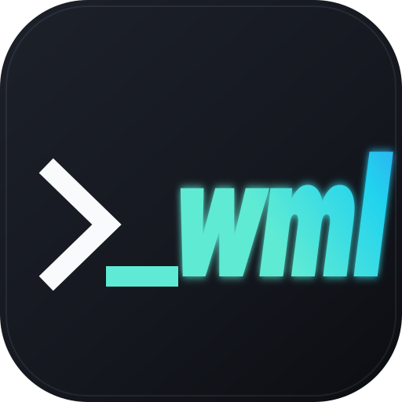

<p align="center">
  
</p>

# WML Update

<p align="center">
  <a href="LICENSE"></a>
  <a href="https://yxxbc.github.io/wmlUpdate/"></a>
  <a href="https://pkg.go.dev/github.com/yxxbc/wmlUpdate"></a>
</p>

面向 Go 应用的轻量更新**库**，附带发版 CLI，以及供其他语言使用的可选 sidecar。

将它作为依赖嵌入，只向应用暴露两个操作：

```go
update, err := updater.Check(ctx)
if update.Available {
    result, err := updater.Apply(ctx, update, wmlupdate.ApplyOptions{})
}
```

没有守护进程、没有框架、没有全局注册、不要求应用架构。UI、生命周期和重启时机
始终由宿主应用掌握。

[English](README.md)

## 为什么做成库

更新器真正困难的是断点续传、篡改校验、三种文件系统模型、Windows 运行中文件、
回滚、崩溃恢复、签名和进度反馈。WML Update 把这些能力收在一个刻意很小的
Go API 后面：

```go
u, err := wmlupdate.New(wmlupdate.Options{
    ConfigPath:     "updater.json",
    CurrentVersion: appVersion,
})
if err != nil { return err }
defer u.Close()

update, err := u.Check(ctx)
if err != nil || !update.Available { return err }

result, err := u.Apply(ctx, update, wmlupdate.ApplyOptions{})
```

`Check` 只读；`Apply` 安装刚才检查到的确切版本，下载并校验后再落盘。进度通过可选
回调提供，最终结果是返回值。同一引擎还提供：

- **发版 CLI**：打包、签名、清单与校验文件；
- **可选 sidecar CLI + NDJSON + HTTP API**：给无法直接导入 Go 库的语言使用。

## 特性

- **Go 库**：公开 API 只有 `Check` 和 `Apply`。
- **低侵入**：无守护进程、无服务、无 UI 框架、无事件循环绑定。
- **Windows / macOS / Linux**，`amd64` / `arm64`；可选 sidecar 为单个 CGO-free 二进制。
- **GitHub Releases 或自托管静态清单**两种更新源，支持有序**多源链**与同版本/
  同 SHA-256 的镜像故障切换。
- **所有安装包强制 SHA-256**，可选 **Ed25519 分离签名**、HTTPS 与域名白名单。
- **目录/单文件事务化安装**，保留备份、崩溃恢复和回滚数据。
- **安全解压**：路径穿越、符号链接逃逸、硬链接、特殊文件、条目/膨胀限制。
- **断点续传**、有界重试与显式代理配置。
- **Windows 延迟应用**：应用仍在运行时也可替换；可选 macOS 签名连续性、隔离清理与 ad-hoc 签名。
- **发版工具**：归档、哈希、签名、清单和校验文件生成。

## 平台范围

官方 Release 二进制面向 **Windows、macOS、Linux** 的 `amd64` / `arm64`：

| 后缀 | 含义 |
| --- | --- |
| `.tar.gz`、`.zip` | CLI 二进制归档 |
| `.deb`、`.rpm` | Linux 发行版安装包 |
| `.apk` | **Alpine Linux** 包，不是 Android APK |

不支持 iOS、iPadOS、Android、鸿蒙应用安装。这个 SDK 面向 Go 桌面端/服务端应用，
不处理移动商店或移动端安装模型。

## 安装

```bash
go get github.com/yxxbc/wmlUpdate
```

```go
import wmlupdate "github.com/yxxbc/wmlUpdate"
```

CLI 可从 Release 下载，或从源码安装：

```bash
go install github.com/yxxbc/wmlUpdate/cmd/wml-update@latest
```

Release 的 `checksums.txt` 使用项目 Ed25519 密钥签名，可用
`signing/release-signing-key.pub.pem` 验证；详见
[signing/README.md](signing/README.md)。

## 配置

库支持完整 `updater.json`，也支持纯 Go 的 `wmlupdate.Config`。最小 GitHub 配置：

```json
{
  "schema_version": 1,
  "app_id": "com.example.myapp",
  "channel": "stable",
  "source": {
    "type": "github",
    "owner": "acme",
    "repo": "myapp",
    "tag_prefix": "v",
    "token_env": "GITHUB_TOKEN"
  },
  "asset_rules": [
    {"os": "darwin", "arch": "arm64", "match": "myapp-{version}-macos-arm64.zip", "format": "zip"},
    {"os": "windows", "arch": "amd64", "match": "myapp-{version}-windows-amd64.zip", "format": "zip"},
    {"os": "linux", "arch": "amd64", "match": "myapp-{version}-linux-amd64.tar.gz", "format": "tar.gz"}
  ],
  "install": {
    "type": "directory",
    "paths": {
      "darwin": "/Applications/MyApp.app",
      "windows": "C:\\Program Files\\MyApp",
      "linux": "/opt/myapp"
    },
    "preserve": ["data/**", "config/**"]
  }
}
```

或用 Go 直接配置：

```go
u, err := wmlupdate.New(wmlupdate.Options{
    CurrentVersion: appVersion,
    Config: &wmlupdate.Config{
        AppID: "com.example.myapp",
        Source: wmlupdate.SourceConfig{
            Type: wmlupdate.SourceGitHub, Owner: "acme", Repo: "myapp",
        },
        Install: wmlupdate.InstallConfig{
            Type: wmlupdate.InstallDirectory, Path: "/opt/myapp",
        },
    },
})
```

详见 [SDK 指南](docs/sdk.md) 和 [配置参考](docs/configuration.md)。

## 在 Go 中集成

```go
u, err := wmlupdate.New(wmlupdate.Options{
    ConfigPath:     "updater.json",
    CurrentVersion: appVersion,
    Events: func(e wmlupdate.Event) {
        if e.Type == wmlupdate.EventProgress {
            reportProgress(e.Percent)
        }
    },
})
if err != nil { return err }
defer u.Close()

update, err := u.Check(ctx)
if err != nil { return err }
if !update.Available {
    return nil
}

result, err := u.Apply(ctx, update, wmlupdate.ApplyOptions{})
if err != nil { return err }
log.Printf("updated %s -> %s", result.PreviousVersion, result.Version)
```

Windows 下目标正在运行时：

```go
result, err := u.Apply(ctx, update, wmlupdate.ApplyOptions{
    Defer:    true,
    WaitPIDs: []int{os.Getpid()},
})
// StatusApplyScheduled：应用退出后由独立 helper 完成替换。
```

库不会调用 `os.Exit`，也不会擅自重启进程；这始终是应用自己的决定。

## 打包发版

CLI 包含发版工作流，可发布到 GitHub Releases 或任意静态站点：

```bash
wml-update keygen --out-dir keys
wml-update publish --spec publish.json --out public/stable --key keys/signing-key.pem
```

`publish.json`：

```json
{
  "app_id": "com.example.myapp",
  "version": "1.2.0",
  "channel": "stable",
  "notes": "修复与改进",
  "assets": [
    {"dir": "dist/app-linux", "url": "myapp-1.2.0-linux-amd64.tar.gz", "os": "linux", "arch": "amd64", "format": "tar.gz"},
    {"dir": "dist/app-windows", "url": "myapp-1.2.0-windows-amd64.zip", "os": "windows", "arch": "amd64", "format": "zip"}
  ]
}
```

输出 `manifest.json`、`manifest.json.sig`、`checksums.txt` 和
`checksums.txt.sig`。先上传安装包，最后上传清单。详见
[自托管](docs/self-hosting.md) 与 [GitHub Releases](docs/github-releases.md)。

## 其他语言

Go 库无法被 Python、Node.js、Java、C# 直接导入。这些应用使用可选 sidecar：

```bash
wml-update --config updater.json --json update --current-version 1.0.0
```

stdout 每行一个 JSON 对象，stderr 用于诊断。同一引擎也可通过以下命令提供
带 token 的本机 HTTP API（异步任务与 SSE）：

```bash
wml-update --config updater.json serve --json
```

详见 [集成文档](docs/integration.md) 与
[Python](examples/python)、[Node.js](examples/node)、[C#](examples/csharp)、
[Shell](examples/shell)、[Go SDK](examples/go)、[CLI Go](examples/go-cli) 示例。

## CLI 命令

对 Go 应用来说 CLI 是可选的，它包含发版工具与 sidecar 适配器。

| 命令 | 作用 |
| --- | --- |
| `publish` | 生成自托管清单、校验文件和签名 |
| `keygen` / `sign` / `verify` | Ed25519 发版签名工具 |
| `check` / `update` | sidecar 检查与应用；`--json` 输出 NDJSON |
| `update --defer --wait-pid <pid>` | 目标运行中时延迟应用 |
| `fetch --output app.zip` | 仅下载并校验 |
| `rollback` / `status` / `doctor` | 运维恢复与诊断 |
| `serve` | 本机 HTTP 集成 API |

## 安全默认值

- 没有 SHA-256 的下载会被拒绝；GitHub API digest 或 `checksums.txt` 提供哈希。
- 配置 `security.public_key_file` 后，自托管清单必须带有效签名，GitHub 校验文件
  必须带有效签名。
- 强制 HTTPS；明文 HTTP 只允许回环地址，或显式开启
  `security.allow_insecure_http`。
- 重定向会重新检查协议、域名白名单和跳转次数。
- 解压拒绝绝对路径、路径穿越、逃逸符号链接、硬链接、设备文件和超限膨胀。
- 目录安装采用暂存 + 事务交换；保留上一版本用于回滚，中断后由日志自动恢复。
- HTTP 适配器必须携带 token，默认只监听回环地址。

请阅读 [安全模型](docs/security.md)。目录安装会管理整个目标目录：新版本中不存在、
且未被 `install.preserve` 匹配的文件会被删除。请指向应用自管目录，不要指向用户主目录。

## 社区

- [LINUX DO](https://linux.do)

## 文档

**Online documentation: <https://yxxbc.github.io/wmlUpdate/>**

- [Go SDK 指南](https://yxxbc.github.io/wmlUpdate/latest/sdk/)
- [Go API 参考](https://pkg.go.dev/github.com/yxxbc/wmlUpdate)
- [架构](docs/architecture.md)
- [配置参考](docs/configuration.md)
- [版本与兼容性](docs/versioning.md)
- [清单格式](docs/manifest.md)
- [集成与 sidecar 协议](docs/integration.md)
- [自托管更新](docs/self-hosting.md)
- [频繁发版指南](docs/frequent-releases.md)
- [GitHub Releases](docs/github-releases.md)
- [安全模型](docs/security.md)
- [测试指南](docs/testing.md)
- [故障排查](docs/troubleshooting.md)
- [架构决策记录](docs/adr)

## 开发

需要 Go 1.24+。

```bash
make test
make check
make build
```

## 许可证

采用 [Apache License 2.0](LICENSE) 授权，署名信息见 [NOTICE](NOTICE)。
WML Update 名称与 logo 为项目标识；Apache-2.0 不授予商标权，也不允许暗示官方背书。
